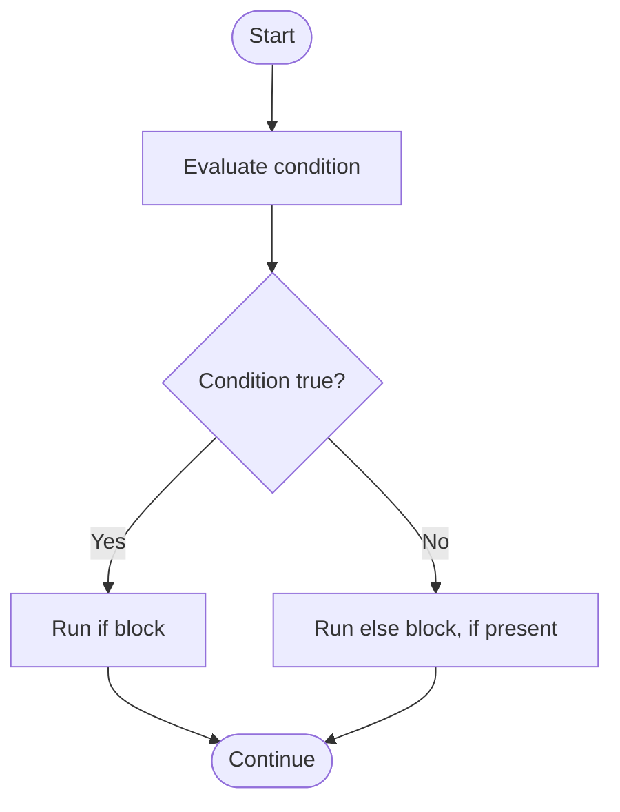
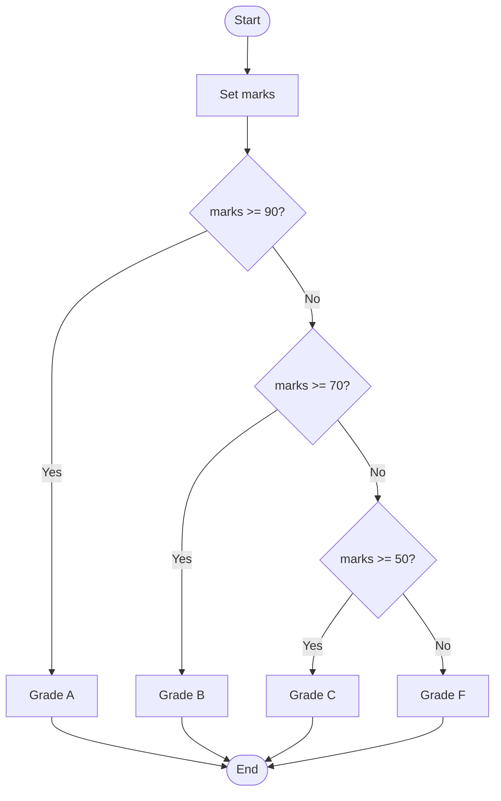
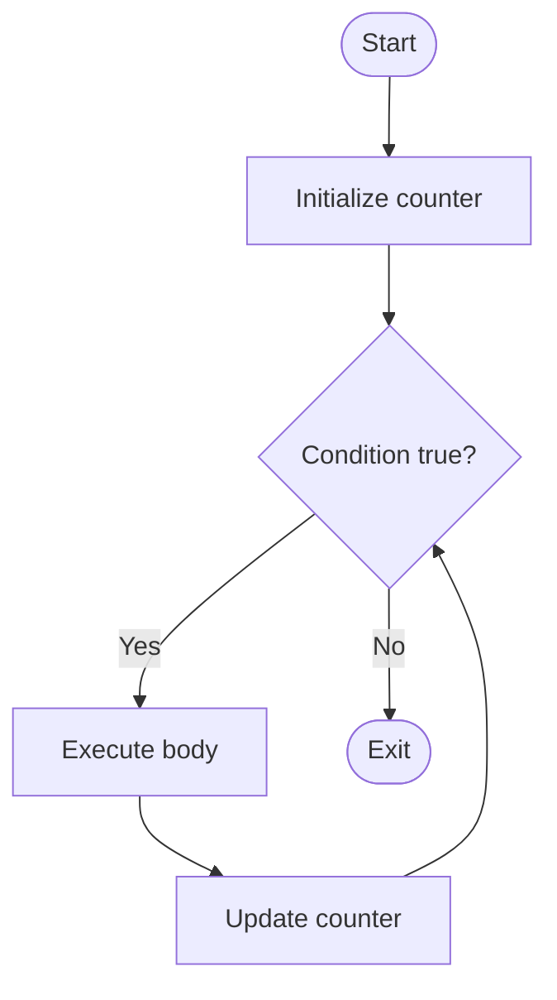
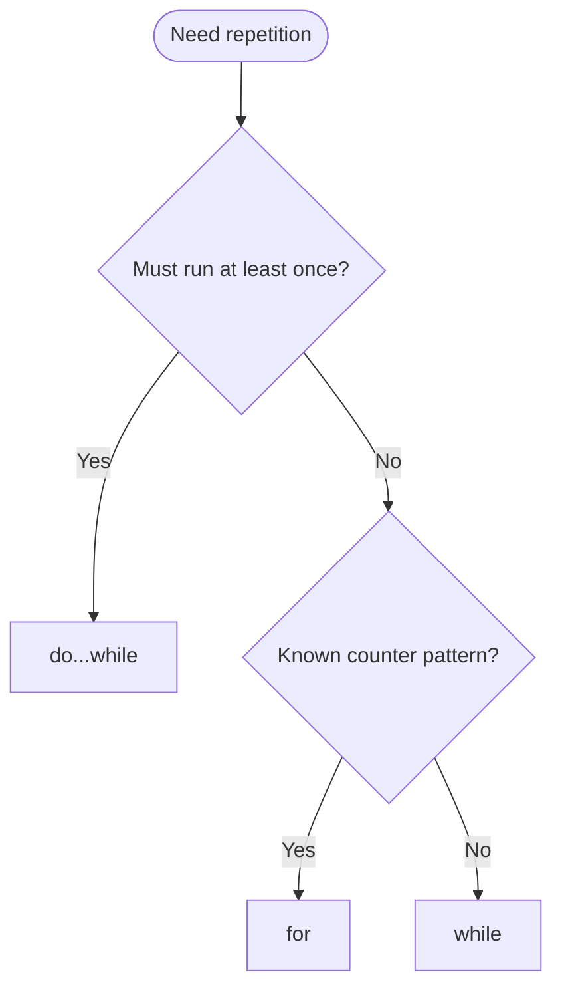

# 🔀 Conditions & Loops in JavaScript

<div align="center">

### Assignment 19 | JavaScript fundamentals, decision making, and iteration

[](https://developer.mozilla.org/en-US/docs/Web/JavaScript)
[](#-assignment-map)
[](LICENSE)

**A beginner-friendly collection of HTML-based JavaScript exercises covering conditional statements and loops.**

</div>

## 📚 Contents
- [🎯 Overview](#-overview)
- [🧠 Learning objectives](#-learning-objectives)
- [🗂️ Assignment map](#-assignment-map)
- [🖥️ Run the exercises](#️-run-the-exercises)
- [🔎 Concepts](#-concepts-explained)
- [🧭 Diagrams](#-program-flow-diagrams)
- [📸 Screenshots](#-existing-output-evidence)
- [🧪 Testing](#-validation-and-testing)
- [📁 Structure](#-repository-structure)
- [🛡️ Security and accessibility](#️-security-and-accessibility)
- [🗺️ Roadmap](#️-roadmap-and-limitations)
- [🤝 Contributing](#-contributing)
- [📖 Documentation](#-documentation-index)

## 🎯 Overview
This repository contains **Assignment 19: Conditions and Loops in JavaScript**. Five standalone HTML exercises under `Assignment_19_Conditions and Loops in JavaScript/` embed their JavaScript in script elements and can be opened directly in a modern browser.

Topics include `if`, `if...else`, `else if`, `switch`, `for`, `while`, and `do...while`; a grade classification example; numeric range iteration; and ascending/descending output.

> ℹ️ This is a static educational repository, not a deployed web application. The current source has no server, database, API, login system, or build pipeline.

## 🧠 Learning objectives
Learners should be able to evaluate Boolean expressions, choose conditional structures, order branches correctly, trace loop initialization and updates, predict console output, and identify off-by-one errors.

## 🗂️ Assignment map
| Exercise | File | Topic | Existing behavior |
|---|---|---|---|
| Q1 | [Q1.html](Assignment_19_Conditions%20and%20Loops%20in%20JavaScript/Q1.html) | Conditional statements | `if`, `if...else`, `switch` |
| Q2 | [Q2.html](Assignment_19_Conditions%20and%20Loops%20in%20JavaScript/Q2.html) | Grade classification | Ordered `if / else if / else` |
| Q3 | [Q3.html](Assignment_19_Conditions%20and%20Loops%20in%20JavaScript/Q3.html) | Loop fundamentals | Three loop types |
| Q4 | [Q4.html](Assignment_19_Conditions%20and%20Loops%20in%20JavaScript/Q4.html) | Numeric range | Logs 6 through 15 |
| Q5 | [Q5.html](Assignment_19_Conditions%20and%20Loops%20in%20JavaScript/Q5.html) | Counting | Ascending 1-25, descending 24-1 |

### 🔍 Exact exercise behavior
- **Q1:** age 20 logs `You are adult`; temperature 28 logs `It is a pleasant weather.`; day `Monday` logs `Today is Monday`.
- **Q2:** `marks = 80` selects the second branch and logs `grade B`.
- **Q3:** each of the three loops logs five numbered messages.
- **Q4:** the loop counter runs from 5 through 14, while the logged expression is `i + 1`, producing 6 through 15. `num1` and `num2` are declared but unused.
- **Q5:** the first loop logs 1 through 25. The second logs 24 down through 1 because it outputs `j - 1` while `j > 1`.

These are source-derived behavior notes, not automated test claims.

## 🖥️ Run the exercises
### Option A: Browser
1. Clone or download the repository.
2. Open a `Q*.html` file in a modern browser.
3. Open Developer Tools with **F12** or **Ctrl + Shift + I**.
4. Select **Console**, then reload the page.

No package installation or environment variables are required.

### Option B: Local static server
```bash
python -m http.server 8000
```
Open `http://localhost:8000/` and navigate to the assignment folder. Direct file opening also works.

### Option C: Node.js
The exercises are HTML files, not standalone JavaScript modules. Copy the relevant script contents into a temporary `.js` file before running `node exercise.js`.

## 🔎 Concepts explained
### 🧭 Conditional statements
| Structure | Purpose |
|---|---|
| `if` | Run code when a condition is truthy |
| `if...else` | Choose between two branches |
| `else if` | Evaluate multiple ordered conditions |
| `switch` | Match an expression to case values |

```js
const score = 80;
if (score >= 90) {
  console.log("Grade A");
} else if (score >= 70) {
  console.log("Grade B");
} else if (score >= 50) {
  console.log("Grade C");
} else {
  console.log("Grade F");
}
```
Conditions are evaluated top to bottom. The first matching branch runs. Validate input ranges separately in a real grading application.

### 🔁 Loop statements
| Loop | Condition check | Minimum executions |
|---|---|---:|
| `for` | Before each iteration | 0 |
| `while` | Before each iteration | 0 |
| `do...while` | After each iteration | 1 |

```js
for (let index = 1; index <= 5; index++) console.log(index);

let count = 1;
while (count <= 5) {
  console.log(count);
  count++;
}

let attempt = 1;
do {
  console.log(attempt);
  attempt++;
} while (attempt <= 5);
```

### ⚠️ Common mistakes
- Forgetting to update a loop variable, creating an infinite loop.
- Using `<` instead of `<=`, or vice versa.
- Placing a broad `else if` before a narrower condition.
- Forgetting `break` in a `switch` when fall-through is not intended.
- Assuming `do...while` can execute zero times.
- Confusing the loop counter with the logged value.

## 🧭 Program flow diagrams
### Conditional decision


### Grade classification


### Loop lifecycle


### Choosing a loop


## 📸 Existing output evidence
Three screenshot files already exist and are preserved.

| Evidence | Preview |
|---|---|
| Q1 |  |
| Q2 |  |
| Q3 |  |

The original `asset/` folder contains seven instructional images referenced by Q1-Q3.

## 🧪 Validation and testing
The original repository has no package manager, test framework, linter, or browser automation. A structural validator is provided at `scripts/validate-exercises.py`.

```bash
python scripts/validate-exercises.py
```
It checks the five exercise files, basic HTML markers, script blocks, and local image references in Q1-Q3. It does not execute JavaScript or prove browser rendering correctness.

## 📁 Repository structure
```text
.
├── .github/                  # Issue forms, workflows, PR template
├── Assignment_19_Conditions and Loops in JavaScript/
│   ├── asset/                # Original instructional images
│   ├── OutPut/               # Existing output screenshots
│   ├── Q1.html               # Conditional examples
│   ├── Q2.html               # Grade classification
│   ├── Q3.html               # Loop examples
│   ├── Q4.html               # Numeric range
│   └── Q5.html               # Ascending / descending
├── docs/                     # Learning and maintainer documentation
├── scripts/                  # Repository validation utilities
├── .editorconfig
├── .gitattributes
├── .gitignore
├── CHANGELOG.md
├── CODE_OF_CONDUCT.md
├── CONTRIBUTING.md
├── LICENSE
├── ROADMAP.md
├── SECURITY.md
└── README.md
```
See [detailed structure guide](docs/project-structure.md).

## 🛡️ Security and accessibility
- Examples use local hard-coded values and browser console output.
- Never commit credentials, tokens, or private information.
- Review external scripts before adding them.
- Keep document language and viewport metadata.
- Add meaningful alt text to instructional images when updating lesson pages.
- Console-only output is not visible to learners who do not open Developer Tools.

No formal security audit or WCAG conformance test is claimed.

## 🗺️ Roadmap and limitations
See [ROADMAP.md](ROADMAP.md). Potential improvements include expected-output examples, learner challenges, automated behavior tests, semantic HTML improvements, and an optional on-page output panel.

Current limitations: hard-coded examples, console-centric output, no automated test suite, and no backend or deployment service. Q4 declares two unused variables. These limitations are documented honestly.

## 🤝 Contributing
Read [CONTRIBUTING.md](CONTRIBUTING.md). Keep examples beginner-friendly, preserve assignment intent, test changed pages in a browser, and update relevant documentation.

## 📖 Documentation index
| Document | Purpose |
|---|---|
| [Product overview](docs/product-overview.md) | Scope and outcomes |
| [Exercise guide](docs/exercises-guide.md) | Detailed Q1-Q5 walkthrough |
| [JavaScript concepts](docs/javascript-concepts.md) | Conditions and loops |
| [Diagrams](docs/diagrams.md) | Flowcharts and sequence diagrams |
| [Project structure](docs/project-structure.md) | Directory and file map |
| [Development](docs/development.md) | Setup and workflow |
| [Testing](docs/testing.md) | Validation approach |
| [Accessibility](docs/accessibility.md) | Inclusive HTML practices |
| [Security](docs/security.md) | Security boundary |
| [Troubleshooting](docs/troubleshooting.md) | Common problems |
| [Templates](docs/templates/README.md) | Reusable templates |

## 📄 License
Released under the [MIT License](LICENSE).

Last updated: 2026-11-17 23:53 UTC
