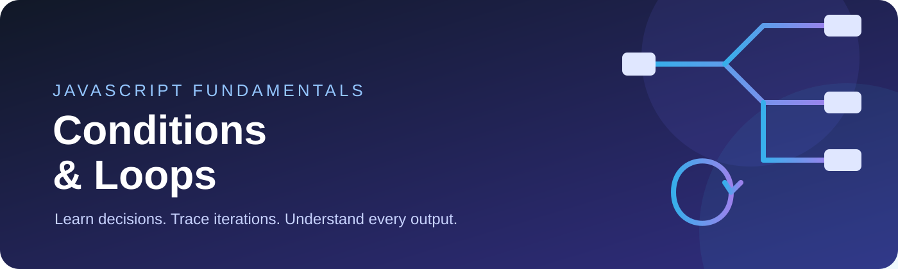
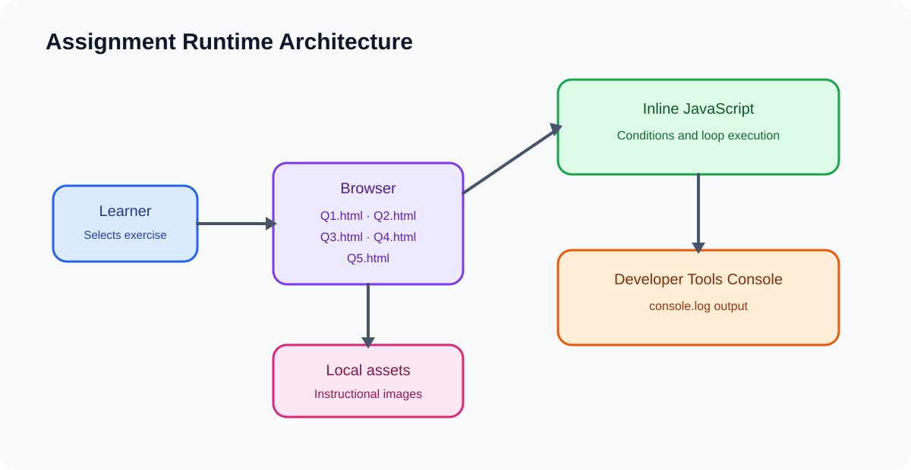
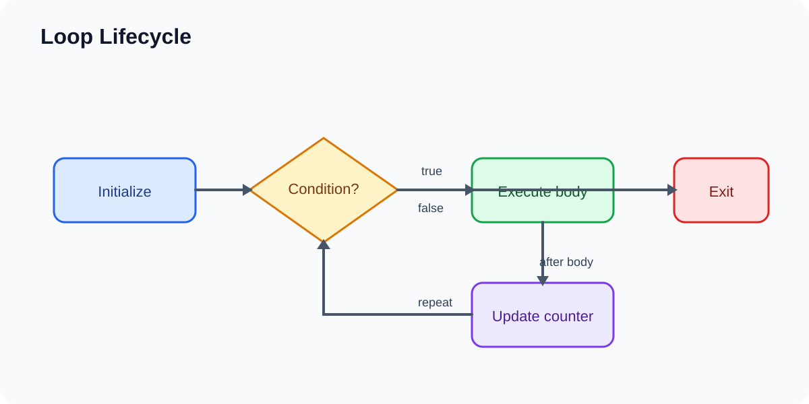
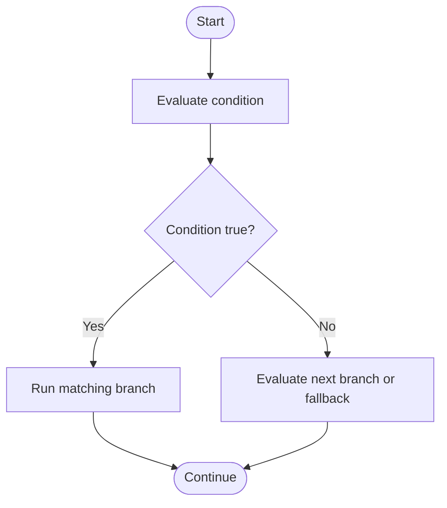
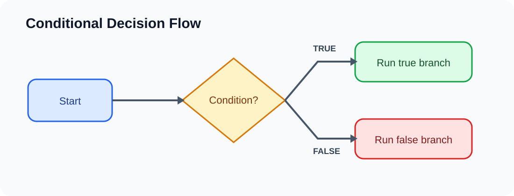
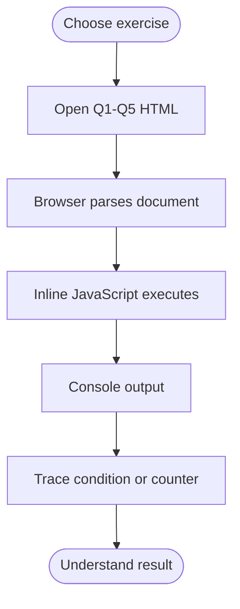

<div align="center">




# 🔀 Conditions & Loops in JavaScript

### Assignment 19 | JavaScript fundamentals, decision making, and iteration

[](https://developer.mozilla.org/en-US/docs/Web/JavaScript)
[](LICENSE)
[](https://github.com/Brajesh31/Condition-and-Loops-in-JS-Assignment/actions/workflows/quality.yml)
[](https://github.com/Brajesh31/Condition-and-Loops-in-JS-Assignment/actions/workflows/docs-validation.yml)

**A beginner-friendly set of five standalone HTML exercises for understanding JavaScript conditions, decisions, and loops.**

[📚 Documentation](docs/README.md) · [🧪 Exercise guide](docs/exercises-guide.md) · [🤝 Contributing](CONTRIBUTING.md) · [🔒 Security](SECURITY.md)

</div>

---

## 📌 Table of Contents

- [🎯 Project overview](#-project-overview)
- [🧠 Learning objectives](#-learning-objectives)
- [✨ Assignment features](#-assignment-features)
- [🗂️ Exercise map](#️-exercise-map)
- [🖥️ Installation and setup](#️-installation-and-setup)
- [▶️ Run the exercises](#️-run-the-exercises)
- [🔎 Concepts and examples](#-concepts-and-examples)
- [🧭 Architecture and diagrams](#-architecture-and-diagrams)
- [📸 Screenshots and assets](#-screenshots-and-assets)
- [📁 Repository structure](#-repository-structure)
- [🧪 Testing and quality](#-testing-and-quality)
- [♿ Accessibility](#-accessibility)
- [🔐 Security and privacy](#-security-and-privacy)
- [⚡ Performance](#-performance)
- [🗺️ Roadmap and known limitations](#️-roadmap-and-known-limitations)
- [❓ FAQ](#-faq)
- [🤝 Contributing](#-contributing)
- [📚 Documentation index](#-documentation-index)
- [👤 Author and license](#-author-and-license)

## 🎯 Project overview

**Conditions & Loops in JavaScript** is a small educational assignment containing five independent HTML pages. Each page embeds JavaScript and demonstrates a specific control-flow concept. Open a page in a browser and inspect its output in Developer Tools.

### 🧩 Problem statement
Beginners need to understand how conditions select a branch, how loops repeat work, and how counter updates affect the final output. Off-by-one errors are especially confusing when the displayed expression differs from the loop counter.

### 💡 Solution
The assignment isolates examples into Q1-Q5 so learners can trace one concept at a time without installing a framework or setting up a backend.

### 📦 Project scope
This is a **static HTML and JavaScript learning repository**, not a deployed web application. The checked-in source has no backend, database, API, authentication, account system, router, package manager, or build pipeline.

## 🧠 Learning objectives

After completing the assignment, learners should be able to:

- Evaluate Boolean conditions and predict branch execution.
- Use `if`, `if...else`, `else if`, and `switch`.
- Understand ordered condition evaluation and switch `break`.
- Compare `for`, `while`, and `do...while`.
- Trace initialization, condition checks, loop bodies, and updates.
- Distinguish the loop counter from the value printed.
- Identify loop termination and off-by-one errors.
- Explain why a post-test loop executes at least once.

## ✨ Assignment features

| Feature | Exercise | Learning outcome |
|---|---|---|
| Conditional branching | Q1 | Select code paths using conditions |
| Switch-case selection | Q1 | Match a value to a case |
| Grade classification | Q2 | Evaluate ordered thresholds |
| Three loop structures | Q3 | Compare loop execution models |
| Numeric range output | Q4 | Trace counter boundaries |
| Ascending and descending output | Q5 | Understand counter transformations |

The repository also contains seven original instructional images and three existing output screenshots.

## 🗂️ Exercise map

| Exercise | File | Concept | Existing behavior |
|---|---|---|---|
| Q1 | [Q1.html](Assignment_19_Conditions%20and%20Loops%20in%20JavaScript/Q1.html) | Conditions and switch | Age 20, temperature 28, Monday |
| Q2 | [Q2.html](Assignment_19_Conditions%20and%20Loops%20in%20JavaScript/Q2.html) | Grade classification | Marks 80 selects grade B |
| Q3 | [Q3.html](Assignment_19_Conditions%20and%20Loops%20in%20JavaScript/Q3.html) | for, while, do...while | Five iterations per loop |
| Q4 | [Q4.html](Assignment_19_Conditions%20and%20Loops%20in%20JavaScript/Q4.html) | Numeric range | Displays 6 through 15 |
| Q5 | [Q5.html](Assignment_19_Conditions%20and%20Loops%20in%20JavaScript/Q5.html) | Counting | 1-25, then 24-1 |

### 🔍 Exact behavior notes

- **Q1:** The age check logs `You are adult`; temperature 28 logs `It is a pleasant weather.`; the Monday switch case logs `Today is Monday`.
- **Q2:** `marks = 80` fails the first threshold and matches the second, logging `grade B`.
- **Q3:** The `for`, `while`, and `do...while` examples each log five numbered messages.
- **Q4:** The counter begins at 5 and runs while less than 15. The script logs `i + 1`, so the visible values are 6 through 15. The declared `num1` and `num2` variables are unused.
- **Q5:** The ascending loop logs `i + 1` for counter values 0-24, displaying 1-25. The descending loop logs `j - 1` while `j > 1`, displaying 24-1.

These details are derived from the existing exercise source. They are not claims of automated browser testing.

## 🖥️ Installation and setup

### Requirements
- A modern browser with JavaScript enabled.
- Git, if you want to clone the repository.
- Python 3, only for optional validation or a local static server.

There is no npm install, package manager setup, environment variable configuration, database provisioning, or build command.

### Clone the repository

```bash
git clone https://github.com/Brajesh31/Condition-and-Loops-in-JS-Assignment.git
cd Condition-and-Loops-in-JS-Assignment
```

You can also download the repository as a ZIP from GitHub.

## ▶️ Run the exercises

### Option 1: Open directly
1. Open the folder `Assignment_19_Conditions and Loops in JavaScript`.
2. Open any `Q1.html` through `Q5.html` file in a browser.
3. Open Developer Tools with **F12** or **Ctrl + Shift + I**.
4. Select **Console**.
5. Reload the page and inspect the output.

### Option 2: Optional local static server

From the repository root:

```bash
python -m http.server 8000
```

Open [http://localhost:8000/](http://localhost:8000/) and navigate into the assignment directory. This serves static files only. It does not create a backend.

## 🔎 Concepts and examples

### 🧭 Conditional statements

```javascript
const score = 80;

if (score >= 90) {
  console.log("Grade A");
} else if (score >= 70) {
  console.log("Grade B");
} else if (score >= 50) {
  console.log("Grade C");
} else {
  console.log("Grade F");
}
```

Conditions are evaluated from top to bottom. The first matching branch runs. For range-based grading, order thresholds carefully and validate the allowed score range separately.

### 🔁 Loop structures

| Loop | Condition timing | Minimum executions |
|---|---|---:|
| `for` | Before each iteration | 0 |
| `while` | Before each iteration | 0 |
| `do...while` | After the body | 1 |

```javascript
for (let count = 1; count <= 5; count++) {
  console.log(count);
}

let whileCount = 1;
while (whileCount <= 5) {
  console.log(whileCount);
  whileCount++;
}

let doCount = 1;
do {
  console.log(doCount);
  doCount++;
} while (doCount <= 5);
```

### ⚠️ Common mistakes
- Forgetting to update a loop variable.
- Using `<` when `<=` was intended.
- Placing a broad condition before a narrower condition.
- Forgetting `break` in a switch when fall-through is unintended.
- Assuming `do...while` can execute zero times.
- Logging a transformed counter and then assuming it is the counter itself.

## 🧭 Architecture and diagrams

### Static assignment architecture



The browser loads one independent HTML page, executes its inline JavaScript, loads any referenced local images, and sends output to Developer Tools.

### Loop lifecycle



### Conditional decision flow



### Decision flow illustration



### Learner workflow



More diagrams, including grade selection, loop sequence, and validation workflow, are in [docs/diagrams.md](docs/diagrams.md).

## 📸 Screenshots and assets

### Existing output screenshots

| Exercise | Screenshot |
|---|---|
| Q1 |  |
| Q2 |  |
| Q3 |  |

The original seven teaching images remain under the assignment's `asset/` directory. Q4 and Q5 do not currently have output screenshots. No mock screenshots have been added.

## 📁 Repository structure

The complete tracked directory tree and explanation of each important file are maintained in [docs/project-structure.md](docs/project-structure.md).

Top-level layout:

```text
.
├── .github/       # Issue forms, discussion templates, workflows
├── Assignment.../ # Original Q1-Q5 pages, assets, screenshots
├── docs/          # Product, technical, security, quality, and operations docs
│   ├── assets/    # Original SVG diagrams and banner
│   └── templates/ # Reusable engineering templates
├── scripts/       # Python repository validation utilities
├── README.md
├── LICENSE
├── SECURITY.md
├── CONTRIBUTING.md
└── CHANGELOG.md
```

## 🧪 Testing and quality

### Structural checks

```bash
python scripts/validate-exercises.py
python scripts/check-project-structure.py
python scripts/validate-docs.py
python scripts/validate-markdown.py
python scripts/security-check.py
```

These checks cover repository structure, basic HTML markers, referenced local images, relative Markdown link targets, basic Markdown hygiene, and a limited private-key marker scan.

**Important limitations:** the structural validator does not execute JavaScript or render pages. The security script is a heuristic, not a dedicated secret scanner. Manual browser checks remain necessary.

### Manual test matrix

| Page | Expected observation |
|---|---|
| Q1 | Adult, pleasant-weather, and Monday messages |
| Q2 | Grade B |
| Q3 | Three groups of five messages |
| Q4 | Values 6 through 15 |
| Q5 | Ascending 1-25, descending 24-1 |

GitHub Actions workflows are configured for repository quality, documentation validation, and a basic security heuristic. Check the Actions tab for actual run results before treating any check as passed.

## ♿ Accessibility

The pages are simple educational HTML documents. The repository includes guidance for semantic structure, image alternatives, keyboard use, contrast, zoom, and screen reader review. WCAG 2.2 AA is an improvement target, not a verified conformance claim.

See [Accessibility documentation](docs/accessibility.md).

## 🔐 Security and privacy

- The current exercises use hard-coded values.
- No application secrets or environment variables are required.
- No backend, database, authentication, analytics, or application cookies are implemented.
- Do not commit credentials or private information.
- Report vulnerabilities privately using [SECURITY.md](SECURITY.md).

See [Security architecture](docs/security-architecture.md), [Threat model](docs/threat-model.md), and [Privacy overview](docs/privacy.md).

## ⚡ Performance

The examples use small fixed loop ranges and constant-time operations. They are learning exercises, not benchmarks. No performance score or SLA is claimed. See [Performance guidance](docs/performance.md).

## 🗺️ Roadmap and known limitations

Potential improvements:
- Add explicit problem statements and expected output to each exercise page.
- Add boundary-value practice questions.
- Add behavior-level automated tests.
- Improve document titles, semantic structure, and image alternatives.
- Consider an accessible on-page output panel.
- Add genuine Q4 and Q5 output evidence if useful.

Current limitations include hard-coded values, Console-only output, no automated JavaScript behavior suite, and no deployed application. See [ROADMAP.md](ROADMAP.md) and [known issues](docs/known-issues.md).

## ❓ FAQ

**Do I need Node.js?**  
No. The existing pages open directly in a browser.

**Why is there no visible output on the page?**  
The examples use `console.log`. Open Developer Tools and select Console.

**Is there a database or backend?**  
No. The repository is a static HTML assignment.

**Why does Q4 start displaying at 6?**  
The loop counter begins at 5, but the script logs the counter plus one.

**Why does the descending Q5 sequence start at 24?**  
The counter starts at 25 and the script logs the counter minus one.

**Where are all the docs?**  
Start at [docs/README.md](docs/README.md).

## 🤝 Contributing

Contributions that improve correctness, clarity, accessibility, or maintainability are welcome. Read [CONTRIBUTING.md](CONTRIBUTING.md), use the issue templates, and test changes before opening a pull request.

## 📚 Documentation index

| Category | Documentation |
|---|---|
| Project and product | [Overview](docs/product-overview.md) · [Background](docs/project-background.md) · [Objectives](docs/project-objectives.md) · [Requirements](docs/functional-requirements.md) · [Scope](docs/scope-and-limitations.md) |
| Exercises and learning | [Q1-Q5 guide](docs/exercises-guide.md) · [JavaScript concepts](docs/javascript-concepts.md) · [Glossary](docs/glossary.md) · [FAQ](docs/faq.md) · [Use cases](docs/use-cases.md) |
| Architecture | [Architecture](docs/architecture.md) · [System design](docs/system-design.md) · [Lifecycle](docs/application-lifecycle.md) · [Diagrams](docs/diagrams.md) · [Project structure](docs/project-structure.md) |
| Development | [Installation](docs/installation.md) · [Getting started](docs/getting-started.md) · [Local development](docs/local-development.md) · [Debugging](docs/debugging.md) · [Commands](docs/commands-reference.md) |
| Quality | [Testing](docs/testing.md) · [QA](docs/qa.md) · [Quality gates](docs/quality-gates.md) · [Test plan](docs/test-plan.md) |
| Security and privacy | [Security](SECURITY.md) · [Threat model](docs/threat-model.md) · [Incident response](docs/incident-response.md) · [Privacy](docs/privacy.md) |
| Accessibility | [Accessibility](docs/accessibility.md) · [WCAG target](docs/wcag-compliance.md) · [Testing](docs/accessibility-testing.md) |
| Operations | [Deployment](docs/deployment.md) · [Maintenance](docs/maintenance.md) · [Known issues](docs/known-issues.md) · [Risk register](docs/risk-register.md) |
| Templates | [Template index](docs/templates/README.md) |

For the full catalog, open the [Documentation Hub](docs/README.md).

## 👤 Author and license

**Maintainer:** Brajesh Kumar  
**Repository:** [Brajesh31/Condition-and-Loops-in-JS-Assignment](https://github.com/Brajesh31/Condition-and-Loops-in-JS-Assignment)

This project is licensed under the [MIT License](LICENSE).

Last updated: 2026-11-17 23:56 UTC
