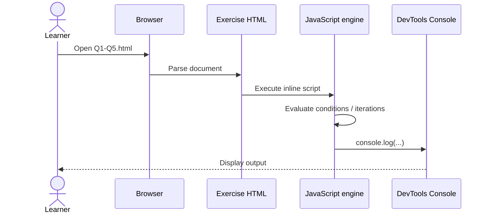

# 🔄 Application and Page Lifecycle

Each exercise is an independent document. The lifecycle is:

1. The learner opens one HTML file.
2. The browser reads and parses its markup.
3. The browser resolves any relative image references.
4. The browser executes the inline script during page parsing.
5. JavaScript evaluates conditions and loop bodies.
6. Calls to `console.log` write messages to the Developer Tools Console.
7. The page remains available until navigation or reload.

There is no client-side router, hydration phase, API request lifecycle, server render, or background worker.
