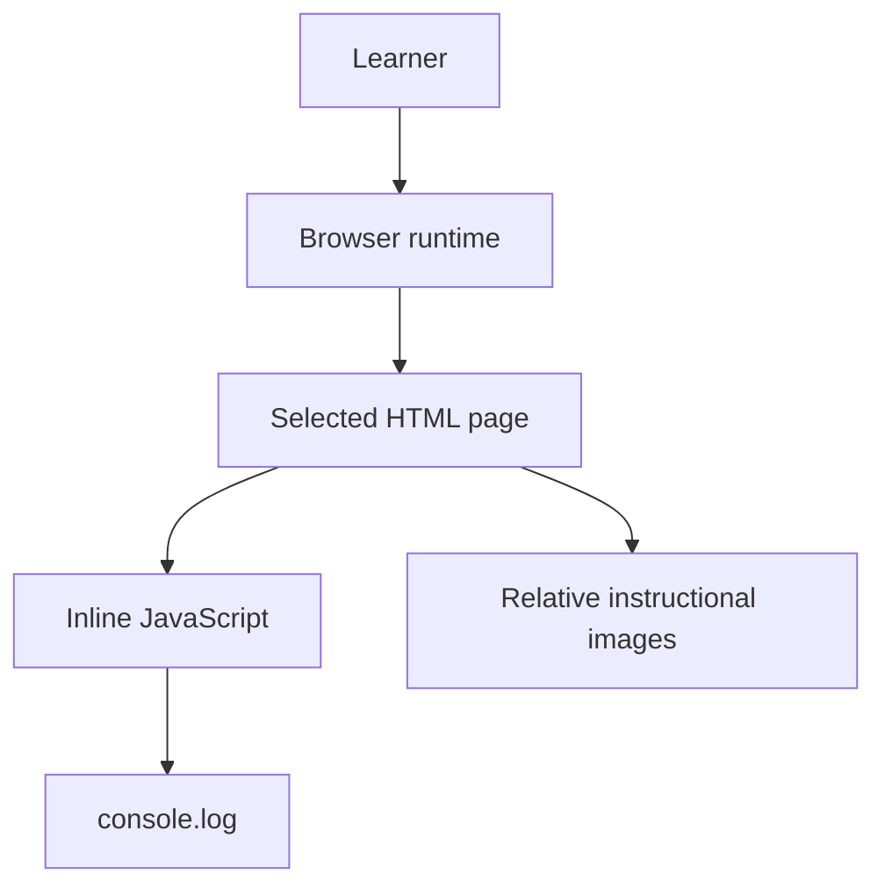

# 🏗️ Architecture

## Architecture style
The repository is a collection of independent static HTML documents. Each page is its own entry point and contains an inline JavaScript script. The browser provides the runtime and Developer Tools provides the visible output surface.

## Component inventory
| Component | Responsibility |
|---|---|
| Q1.html | Conditional and switch examples |
| Q2.html | Grade classification |
| Q3.html | Three loop constructs |
| Q4.html | Numeric range iteration |
| Q5.html | Ascending and descending counters |
| asset/ | Images referenced by lesson pages |
| OutPut/ | Existing screenshots for Q1-Q3 |
| Browser | Parses HTML and executes JavaScript |
| Developer Tools | Displays console output |

## Runtime architecture

## Design decisions
- Independent pages keep the learning examples isolated.
- Inline scripts avoid build tooling for simple concepts.
- Console output avoids introducing an artificial UI layer.
- Original assignment logic is preserved; documentation explains quirks rather than silently changing them.

## Not applicable
There are no frontend/backend layers, route table, services, database, API, authentication subsystem, or deployment topology in the current code.
