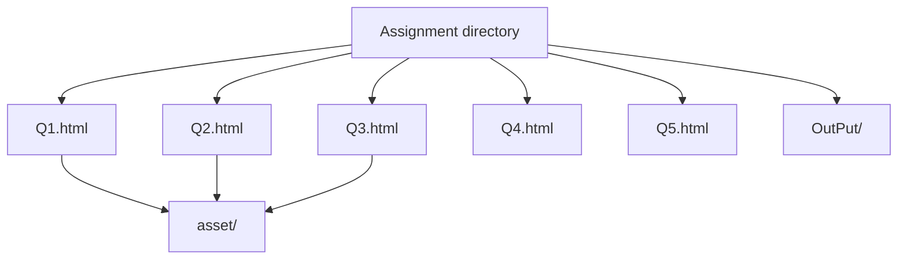

# 🧩 Component Architecture

This repository does not use a component framework. Its meaningful units are independent pages and their embedded scripts.

| Unit | Responsibility | Coupling |
|---|---|---|
| Q1.html | Conditional examples | Independent |
| Q2.html | Grade branch example | Independent |
| Q3.html | Loop comparison | Independent |
| Q4.html | Numeric range example | Independent |
| Q5.html | Counting examples | Independent |
| asset/ | Lesson illustrations | Referenced by Q1-Q3 |
| OutPut/ | Existing visual evidence | Stored screenshots |

## Relationship diagram

No React components, reusable UI library, or module import graph is present.
