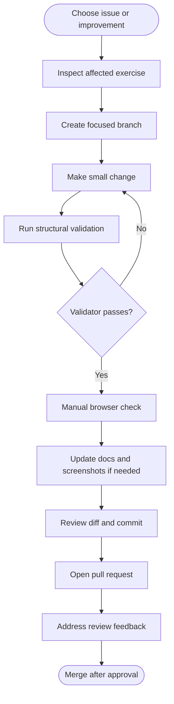

# 🔄 Development Workflow

## Principles
- Preserve original assignment content unless a behavior change is intentional.
- Keep the change focused.
- Do not fabricate screenshot evidence or test outcomes.
- Update documentation with code changes.
- State any checks that could not be run.
