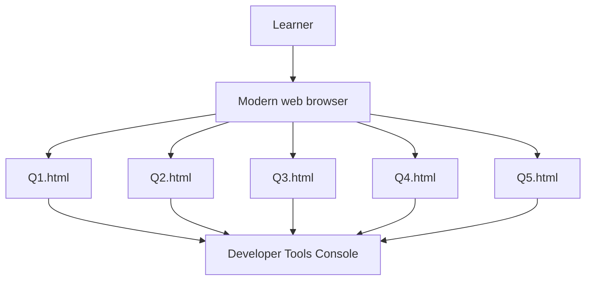
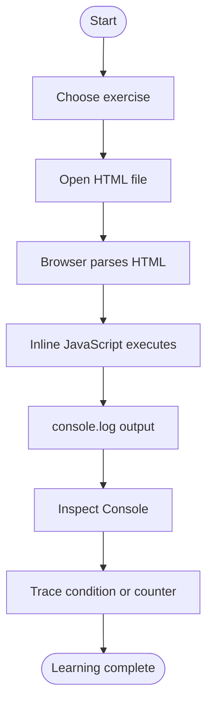
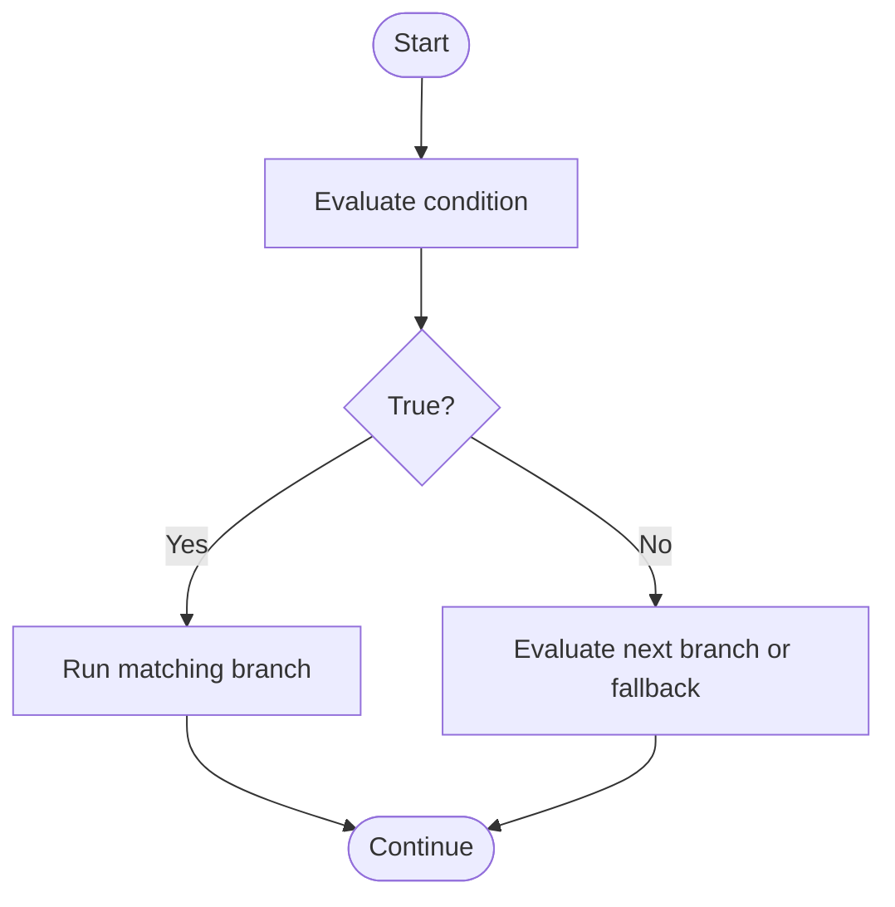
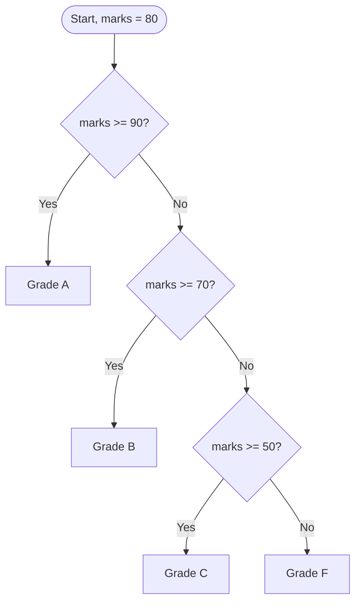
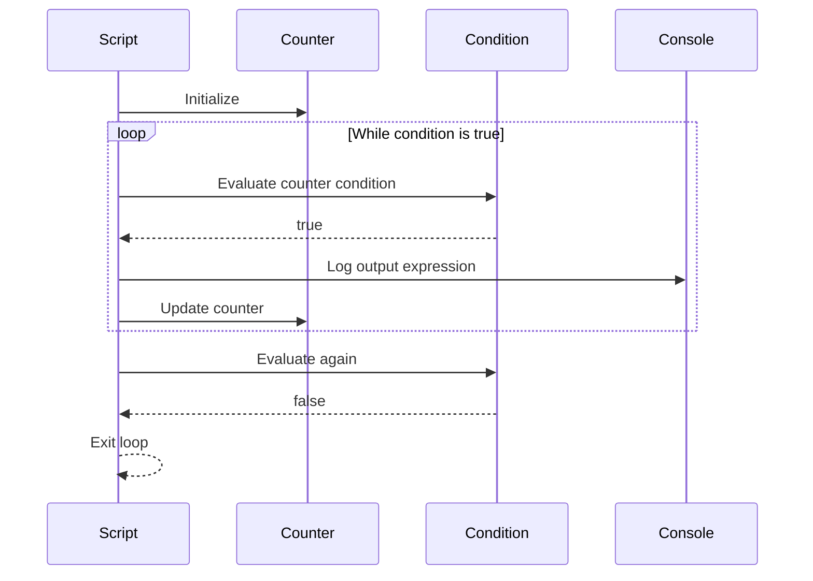
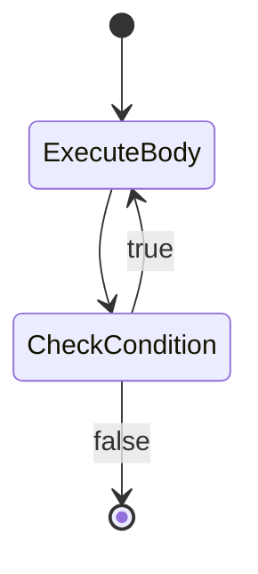
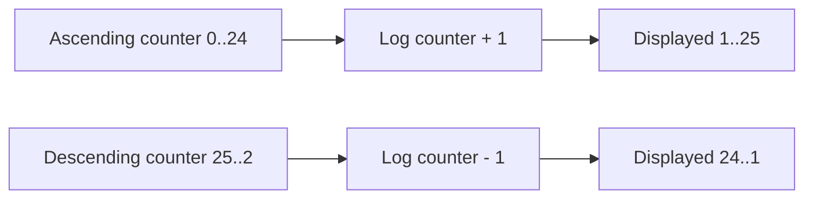
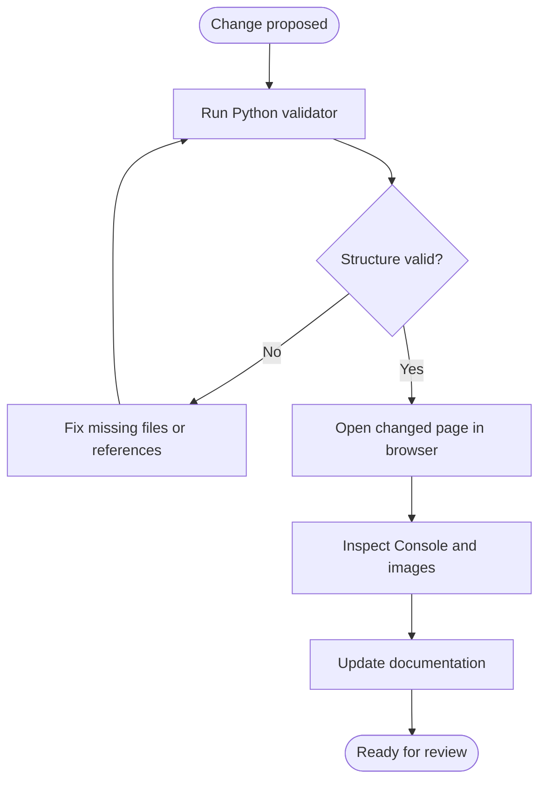

# 🧭 Project and Control-Flow Diagrams

The diagrams below model only the checked-in static assignment. Authentication, API, database, and server diagrams are not applicable to the current architecture.

## 🏗️ High-level architecture

## 🔁 Overall learner workflow

## 🧭 Conditional flow

## 🏅 Grade decision flow

## 🔂 Pre-test loop sequence

## 🔄 do...while state

## ↕️ Q5 output transformation

## 🧪 Validation workflow

