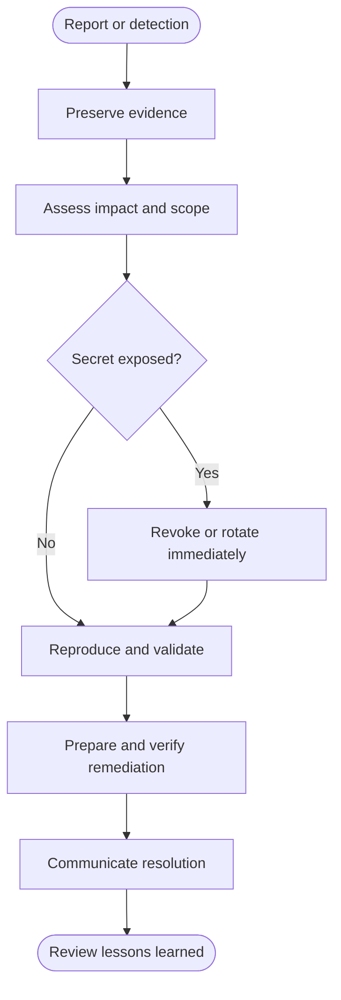

# 🚨 Incident Response

## Scope
This procedure covers accidental secret exposure, compromised workflow credentials, malicious repository changes, and credible security vulnerabilities.

## Response stages

## Actions
1. Preserve relevant commits, workflow logs, and timestamps.
2. Determine affected files, branches, and tokens.
3. Revoke exposed credentials immediately.
4. Correct the source or workflow and verify the fix.
5. Notify affected parties where appropriate.
6. Record the outcome without republishing sensitive data.

## Escalation
Use the private contact route described in root [SECURITY.md](../SECURITY.md). The project is best-effort and does not have a formal incident response team or SLA.
