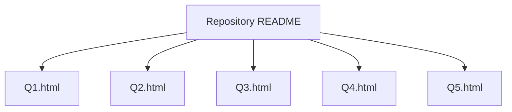

# 🧭 Navigation Structure

## Current navigation
There is no application router or shared navigation menu. Learners navigate from the repository README to one of five independent HTML files.

## Exercise sequence
A useful learning order is Q1 conditional statements, Q2 grade classification, Q3 loop comparison, Q4 numeric range, and Q5 ascending/descending counters. This is a suggested reading order, not an enforced route sequence.

## Future navigation
If a common landing page is introduced, it should link to each exercise and include keyboard-accessible navigation. No SPA routes should be documented until they exist.
