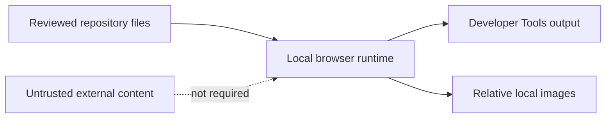

# 🔐 Security Architecture

## Current architecture boundary
This repository is static HTML with inline JavaScript. The examples use hard-coded values and `console.log`. There is no backend, database, API, authentication, authorization, session management, or user-data processing.

## Trust boundary

## Security controls and limitations
- The source has no secret configuration requirement.
- Local images are loaded through relative references.
- The repository should avoid unnecessary external scripts.
- Future user-input examples must validate input and avoid unsafe HTML insertion.
- GitHub workflows should use read-only permissions unless a write permission is genuinely required.

This is an architecture description and guidance, not a penetration test or formal security certification.
