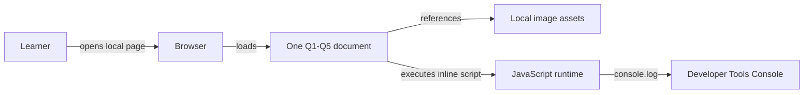

# 🧱 System Design

## System boundary
The system consists of five independent HTML files, local image assets, and the browser runtime. The browser parses a selected page and executes its inline script. Console messages are the primary output channel.

## Context diagram

## Data and state
All exercise values are hard-coded in the page scripts. State is held in local JavaScript variables during page execution. There is no persistence, remote data source, or database.

## Reliability considerations
The examples should terminate for their documented initial values. Any new loop exercise should include a clear update path and a bounded example to prevent accidental infinite loops.
