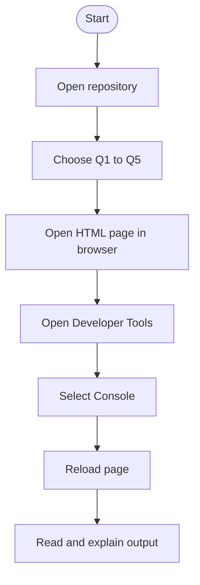

# 🧭 Learner Journeys

## Journey A: Open and inspect an exercise

## Journey B: Understand a loop
1. Open Q3, Q4, or Q5.
2. Identify initialization.
3. Read the loop condition.
4. Trace the body and output expression.
5. Apply the update.
6. Repeat until the condition becomes false.
7. Compare the predicted output with the Console.

## Journey C: Contribute a correction
1. Read the contribution guide.
2. Reproduce the behavior.
3. Make a focused change.
4. Run the structural validator.
5. Test the page in a browser.
6. Update documentation and submit a pull request.
